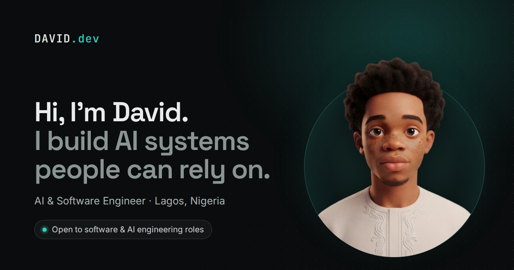

# DAVID.dev — Portfolio

My personal portfolio: a single-page site introducing who I am, what I've worked on and how to reach me.

Built with **React 19**, **TypeScript**, **Tailwind CSS 4** and **Vite**, deployed on **Vercel**.

**Live: [davidrapu.tech](https://davidrapu.tech)**



## Features

- **Hero** with a pop-out avatar and a one-time entrance animation
- **Skills ticker**: an endless, pausable marquee of tech logos (from [Simple Icons](https://simpleicons.org))
- **About**: education, a featured result, GitHub repos and tech stack
- **Experience timeline**: a dot follows your scroll down the timeline, and each entry slides in from its side as the dot reaches it (and out again on the way back up)
- **Projects**: *Featured* and *Others* tabs. Featured rows alternate sides with a framed preview that lifts on hover; the Others list shows a floating preview on hover
- **Contact**: email link plus a *Copy email* button with "Copied" feedback
- **Sticky header** whose nav highlights the section you're reading

### Accessibility and polish

- Respects **reduced motion**: animations become simple fades, nothing slides or tilts, and the ticker stops
- Visible **keyboard focus** everywhere; the project tabs work with the arrow keys
- Works on phones: the nav moves to its own row, layouts stack, nothing scrolls sideways
- Animations use `transform` and `opacity` only, with shared easing tokens

## Getting started

Requires **Node.js 20+**.

```bash
npm install
npm run dev
```

Then open http://localhost:5173.

| Command | What it does |
|---|---|
| `npm run dev` | Start the dev server with hot reload |
| `npm run build` | Type-check and build for production into `dist/` |
| `npm run preview` | Serve the production build locally |
| `npm run lint` | Run ESLint |

## Project structure

```
src/
  App.tsx              Page layout: header, sections in order, footer
  index.css            Tailwind import, design tokens (@theme) and base styles
  data/                ← All site content lives here
    about.ts           Course modules, featured repos, tech stack groups
    contact.ts         Email, GitHub and LinkedIn links
    experience.ts      Timeline entries (newest first)
    projects.ts        Featured and other projects
    skills.ts          Skills shown in the ticker
  layouts/             One component per page section
    Header.tsx, SectionNav.tsx, Hero.tsx, SkillsTicker/, About.tsx,
    Experience.tsx, Projects/, Contact.tsx, Footer.tsx
  components/          Small shared pieces: Card, Pill, IconLink, icons
  hooks/               useActiveSection (nav highlight), useScrolled (header background)
  lib/                 styles.ts (button press feedback), links.ts (external link props)
  assets/              Avatar and project screenshots (imported, so Vite fingerprints them)
public/                Favicons, social preview image, web manifest
```

## Updating the content

Almost everything is data, so you rarely need to touch a component.

- **Add a job or certificate**: add an entry to `src/data/experience.ts`. Newest first; entries alternate left and right automatically.
- **Add a project**: add an object to `featuredProjects` or `otherProjects` in `src/data/projects.ts`. Numbering, left/right alternation, tab counts and the "Live site" button (only shown when `live` is set) all follow automatically. For the preview, either:
  - add a screenshot to `src/assets/projects/`, import it at the top of `projects.ts` and use `visual: { kind: "screenshot", src, alt }`, or
  - reuse a drawn preview: `chat`, `tracker`, `scores`, `network`, `fitness`, `trigram` or `terminal` (defined in `src/layouts/Projects/ProjectVisual.tsx`).
- **Add a skill to the ticker**: import its icon from `simple-icons` in `src/data/skills.ts` and add `{ label, icon }`. Only skills with a logo go in the ticker; others belong in the tech stack in `src/data/about.ts`.
- **Change contact details**: edit `src/data/contact.ts`.

## Design tokens

Colours, fonts, radii, shadows and easing curves are defined once in the `@theme` block of `src/index.css` and used as Tailwind classes, for example `bg-surface`, `text-muted`, `text-accent`, `font-display`, `rounded-card`, `shadow-button` and `ease-out`.

| Token | Value | Used for |
|---|---|---|
| `--color-page` | `#0A0C0D` | Page background |
| `--color-accent` | `#2DD4BF` | Teal highlights |
| `--font-display` | Space Grotesk | Headings |
| `--font-sans` | Inter | Body text |
| `--font-mono` | JetBrains Mono | Labels, logo, ticker |
| `--ease-out` | `cubic-bezier(0.23, 1, 0.32, 1)` | Entrances, hovers, press feedback |
| `--ease-in-out` | `cubic-bezier(0.77, 0, 0.175, 1)` | Things moving on screen (nav and tab indicators) |

## Deployment

Deployed on Vercel. With the GitHub repo connected to the Vercel project, every push to the main branch builds and deploys automatically. Vercel detects Vite, so no extra configuration is needed (build command `npm run build`, output directory `dist`).

The site is served at **https://davidrapu.tech**. `index.html` points `og:image`, `og:url` and the canonical link at that domain, so link previews on LinkedIn, Slack and X show the social image. If the domain ever changes, update those three tags.

## Credits

- Brand logos: [Simple Icons](https://simpleicons.org) (`simple-icons` on npm)
- Fonts: [Inter](https://rsms.me/inter/), [Space Grotesk](https://fonts.google.com/specimen/Space+Grotesk) and [JetBrains Mono](https://www.jetbrains.com/lp/mono/), via Google Fonts

---

© David Rapu · [GitHub](https://github.com/davidrapu) · [LinkedIn](https://www.linkedin.com/in/davidrapu)
